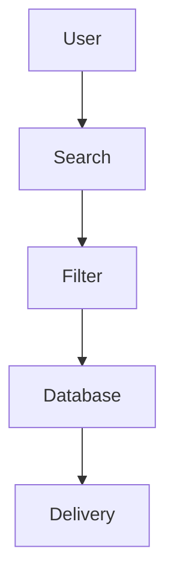

<!-- 🔥 HEADER -->

<p align="center">
  
</p>

<p align="center">
  
</p>

---

<div align="center">

| 🚀 SYSTEM | ⚡ ENGINE | 🎬 EXPERIENCE | 📊 SCALE |
| --------- | -------- | ------------- | -------- |
| 🟢 LIVE   | ⚡ FAST   | 🤖 SMART BOT  | 🔥 HIGH  |

</div>

---

<p align="center">
  
  
  
  
  
</p>

---

# 🤖 Live Bot

<p align="center">
  <a href="https://t.me/SeriesSpaceBot">
    
  </a>
</p>

---

# 🎥 Live Demo

<p align="center">
  
</p>

<p align="center">
  🔍 Search → 🎬 Choose → 📦 Instant Episode Delivery
</p>

---

# ✨ Features

```text
🎬 Smart Series Search Engine
📦 Ordered Episode Delivery
⚡ High-Speed Indexing System
🔍 Auto Suggest + Fix
🎯 Season → Language → Quality Flow
🔐 Force Subscription System
🎨 Poster + Metadata
📊 Stats & Broadcast
🗄️ MongoDB + SQLite
🔥 Batch Sending
🔄 Resume Support
🧠 Intelligent Filtering
```

---

# 🧠 System Flow



---

# 🚀 Installation

```bash
git clone https://github.com/yourrepo
cd cyber-series-bot
pip install -r requirements.txt
```

---

# 🔑 Configuration

```python
API_ID=
API_HASH=
BOT_TOKEN=

MONGO_URI_CONFIG=
MONGO_URI_DB1=
MONGO_URI_DB2=
```

---

# ▶️ Run

```bash
python main.py
```

---

# ☁️ Deploy

<details><summary>🚀 Heroku</summary>

<a href="#">

</a>

</details>

<details><summary>⚡ Render</summary>

Build: pip install -r requirements.txt
Start: python main.py

</details>

---

# 💬 Support & Contribution

<p align="center">
  <a href="https://t.me/MLZ_BOTZ_SUPPORT">
    
  </a>
</p>

---

### ⚠️ Note

This code is built using **developer brain 🧠 + AI 🤖 support**.
So sometimes it may face:

* Bugs
* Errors
* Small issues

---

### 🛠 Need Help?

👉 Join support: **MLZ_BOTZ_SUPPORT**
👉 Report bugs freely

---

### 👨‍💻 Developers

If you are a developer:

* Fork and improve
* Fix bugs
* Commit changes

> Clean contributions are always welcome.

---

### ❤️ Final Words

This project is built to be:

⚡ Fast
🧠 Smart
🎬 User Friendly

Thanks for your support ❤️

---

# ⚠️ Disclaimer

* Do not sell this code
* Give credits
* Educational use only

---

<p align="center">
  
</p>

<p align="center">
  💎 <b>Series Filter Bot — Smart, Fast, Powerful</b>
</p>
