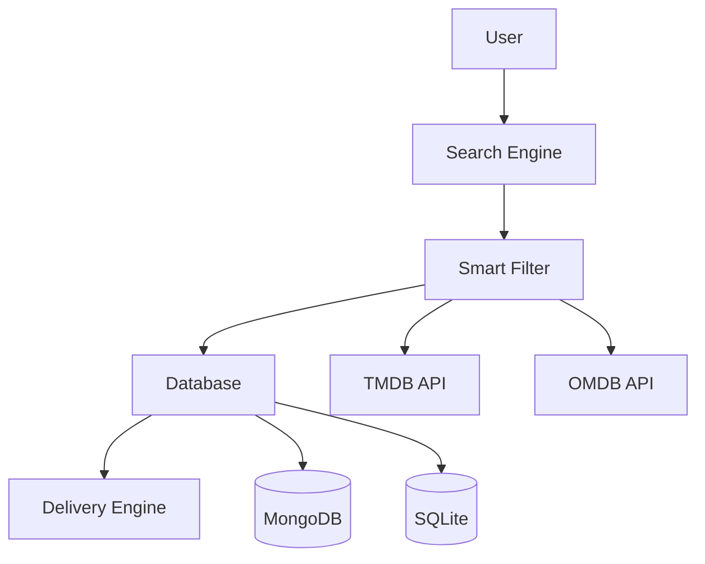

<!-- 🔥 ANIMATED HEADER -->

<p align="center">
  
</p>

<p align="center">
  
</p>

---

<!-- 🧊 GLASS CARDS -->

<div align="center">

| 🚀 SYSTEM | ⚡ ENGINE | 🎬 EXPERIENCE | 📊 SCALE |
| --------- | -------- | ------------- | -------- |
| 🟢 LIVE   | ⚡ FAST   | 🤖 SMART BOT  | 🔥 HIGH  |

</div>

---

<!-- 🌈 BADGES -->

<p align="center">
  
  
  
  
  
</p>

---

# 🤖 Live Bot

<p align="center">
  <a href="https://t.me/SeriesSpaceBot">
    
  </a>
</p>

<p align="center">
  👉 Click above to test the bot instantly
</p>

---

# 🎥 Live Demo

<p align="center">
  
</p>

<p align="center">
  🔍 Search → 🎬 Choose → 📦 Instant Episode Delivery
</p>

---

# ✨ Features

```id="featuresfinal2"
🎬 Smart Series Search Engine
📦 Ordered Episode Delivery (No Random Sending)
⚡ High-Speed Indexing System
🔍 Auto Suggest + Spelling Fix
🎯 Season → Language → Quality Flow
🔐 Force Subscription System
🎨 Poster + Metadata (TMDB / OMDB)
📊 Stats + Broadcast System
🗄️ Multi-DB Architecture (Mongo + SQLite)
🔥 Batch Send (10 per album)
🔄 Resume Interrupted Delivery
🧠 Intelligent Filtering Engine
```

---

# 🧠 System Flow



---

# 🚀 Installation

```bash id="installfinal2"
git clone https://github.com/yourrepo
cd cyber-series-bot
pip install -r requirements.txt
```

---

# 🔑 Configuration

```id="configfinal2"
API_ID=
API_HASH=
BOT_TOKEN=

MONGO_URI_CONFIG=
MONGO_URI_DB1=
MONGO_URI_DB2=
```

---

# ▶️ Run

```bash id="runfinal2"
python main.py
```

---

# ☁️ Deploy

<details><summary>🚀 Deploy to Heroku</summary>

<a href="#">

</a>

</details>

<details><summary>⚡ Deploy to Render</summary>

Build: pip install -r requirements.txt
Start: python main.py

</details>

<details><summary>🖥 VPS</summary>

git clone repo
pip install -r requirements.txt
python main.py

</details>

---

# 👨‍💻 Developer

**Afsal**
🔗 https://github.com/itsafxal
🔗 https://t.me/CyberTGz

---

# ⭐ Support

If you like this project:

⭐ Star
🍴 Fork
🚀 Share

---

# ⚠️ Disclaimer

* Do not resell
* Give proper credits
* Educational use only

---

<!-- 🌊 FOOTER -->

<p align="center">
  
</p>

<p align="center">
  💎 <b>Series Filter Bot — Smart, Fast, Powerful</b>
</p>
